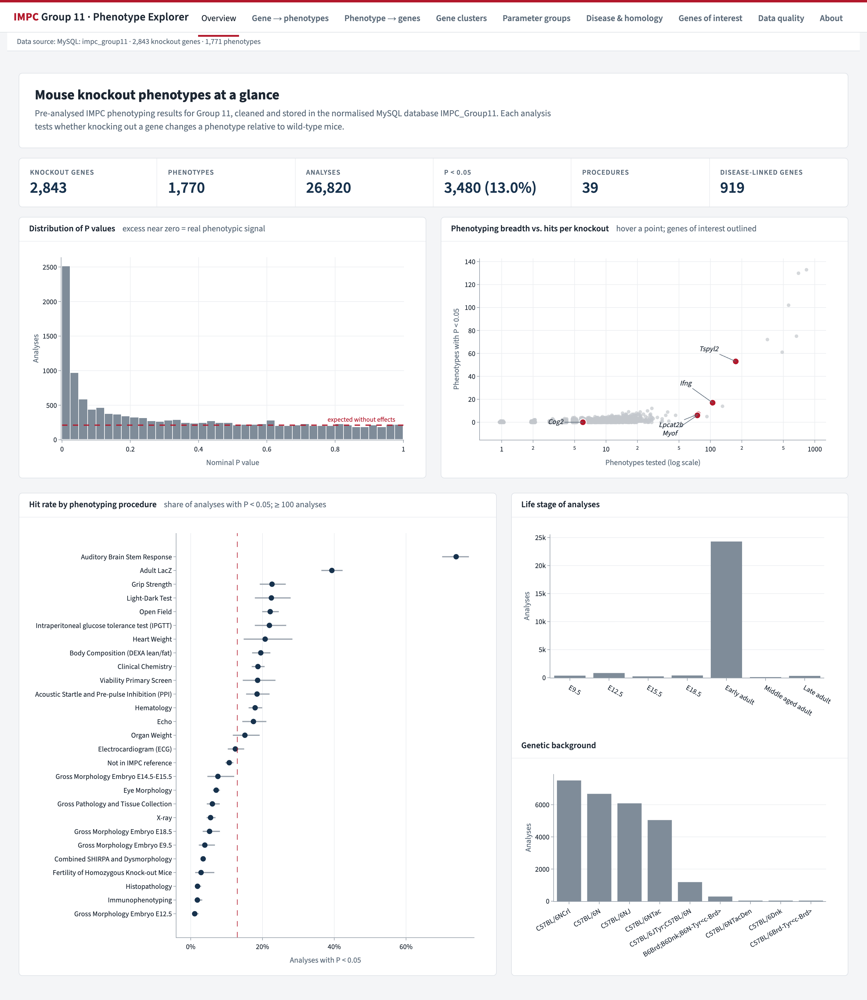
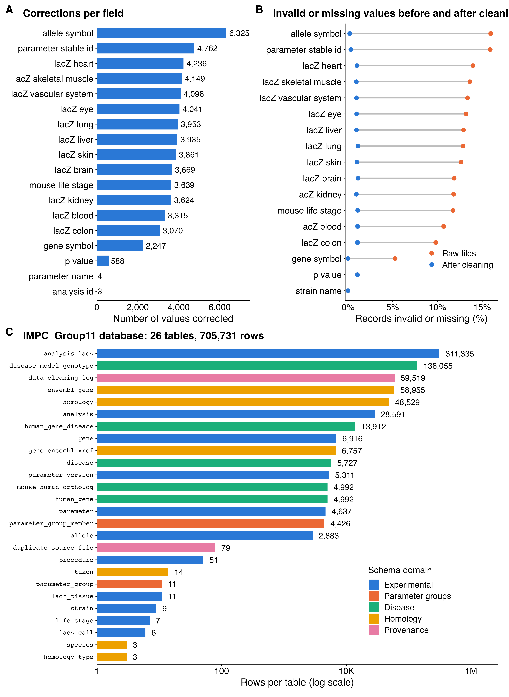
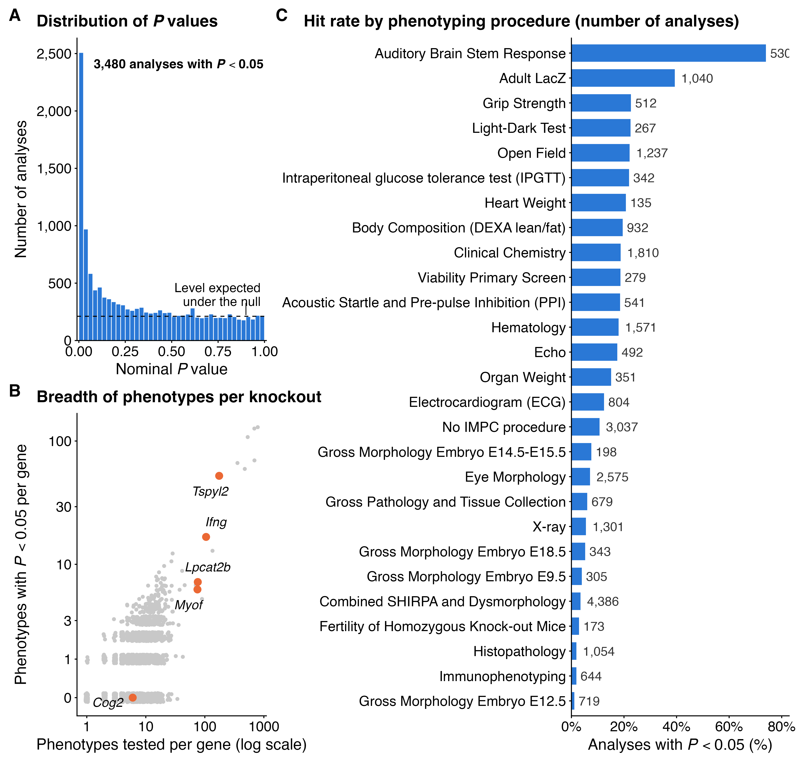
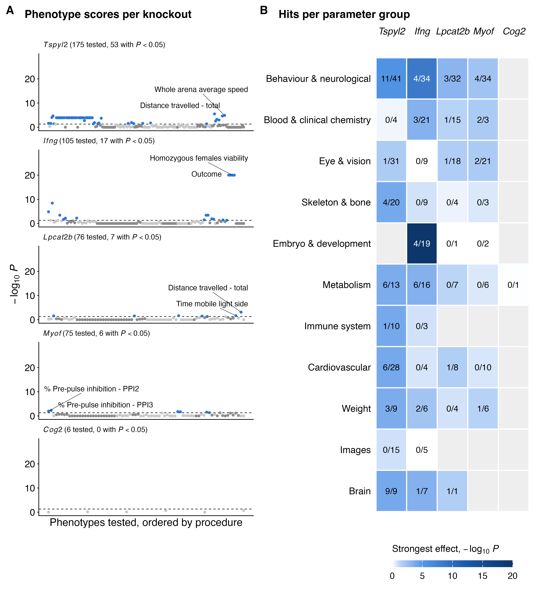
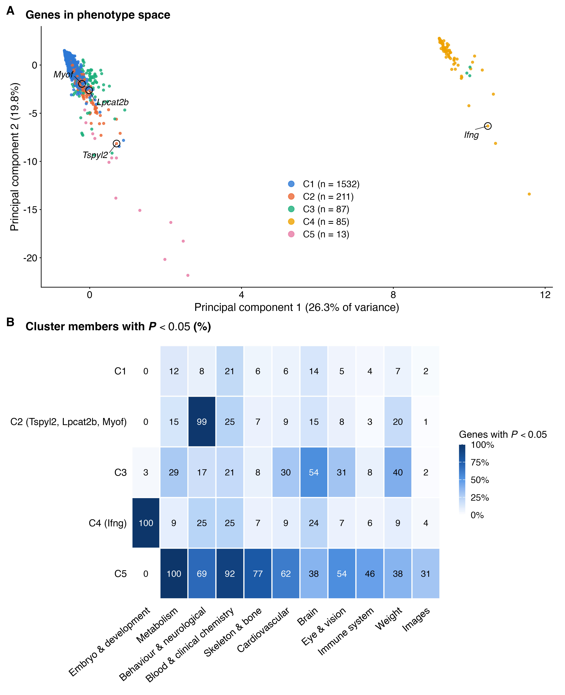
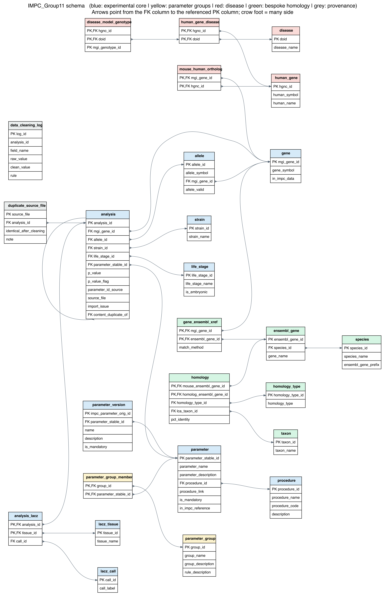

# IMPC Group 11: data cleaning, MySQL database and RShiny dashboard

Coursework for **7BBG1003 Data Cleaning and Data Management** (Group 11).
Database name: **`IMPC_Group11`**

This repository turns the IMPC pre-analysed phenotyping files egressed from the King's TRE into:

1. a reproducible **R cleaning pipeline** with a complete audit trail,
2. a normalised **MySQL database** (26 tables and 4 views), supplied as a restorable dump,
3. an **RShiny dashboard** with the three visualisations the collaborator asked for,
4. **SQL queries** for the collaborator's genes of interest, with their results and figures.

## Repository layout

| Path | Contents |
|---|---|
| `R/01_clean_data.R` | Imports the 28,670 raw analysis files and all reference files, cleans them and writes database-ready tables to `clean_data/` |
| `R/02_build_database.R` | Creates the schema, loads the tables, creates the views and checks row counts against the cleaned tables |
| `R/03_export_results.R` | Runs the collaborator queries (`results/queries/`), draws the report figures (`results/figures/`) and exports the dashboard's offline snapshot |
| `R/04_schema_diagram.R` | Draws the ER diagram (`docs/ER_diagram.png`, `docs/ER_diagram.svg`) |
| `R/06_dashboard_screenshots.R`, `R/07_dashboard_composite.py` | Capture dashboard screenshots (`results/figures/dashboard/`) through the app's shareable links |
| `R/05_report_figures.R` | Draws ten multi-panel figures (vector PDF + 600 dpi PNG) in `results/figures/report/`, with legends in `FIGURE_LEGENDS.md` |
| `sql/00_create_db_user.sql` | Creates the database and a project user (run once as MySQL root) |
| `sql/01_schema.sql` | DDL: tables, primary/foreign keys, CHECK constraints, indexes |
| `sql/02_views.sql` | Views for collaborators and the dashboard, including `v_analysis_fdr` (Benjamini–Hochberg q-values computed in SQL with window functions) |
| `sql/03_collaborator_queries.sql` | Queries for the genes of interest |
| `database/IMPC_Group11_dump.sql` | **Full database backup (mysqldump)** |
| `shiny/` | RShiny app (`app.R`, `R/plots.R`, `R/data_access.R`, `data/dashboard_snapshot.rds`) |
| `clean_data/` | Cleaned tables (TSV), cleaning log and validation reports |
| `results/` | Query results (CSV) and figures (PNG) |
| `validation_previous/` | Earlier exploratory validation reports produced on CREATE HPC |
| `run_pipeline.sh` | Runs the whole pipeline end to end |

## Quick start

New to the app? Start with the [dashboard quickstart guide (PDF)](docs/Group11_Dashboard_Quickstart_Guide.pdf).

### 1. Restore the database from the dump

```bash
mysql -u root -p < sql/00_create_db_user.sql
```

```bash
mysql -u root -p < database/IMPC_Group11_dump.sql
```

Then copy `db_config.example.cnf` to `db_config.cnf` and fill in your credentials.

### 2. Launch the dashboard

```r
install.packages(c("shiny", "bslib", "plotly", "DT", "data.table", "ggplot2", "DBI", "RMariaDB"))
shiny::runApp("shiny")
```

The dashboard has 13 tabs: Overview, Gene → phenotypes, Phenotype → genes, Interactive cluster explorer, Parameter groups, Disease & homology, Genes of interest, Gene comparison, Phenotype enrichment, Search & network, Gene HTML report, Data quality and About. It also includes side-by-side gene comparison, Fisher exact parameter-group enrichment tests with BH correction, global search with live suggestions/type filters/clickable results/result statistics/CSV export, an interactive gene–phenotype–disease network with phenotype detail and CSV export, and downloadable standalone HTML gene reports. Views can be opened directly with a link such as `http://localhost:4011/?tab=gene&gene=Tspyl2` or `?tab=phenotype&param=IMPC_DXA_007_001`.



If `db_config.cnf` (or the file named by the `IMPC_DB_CNF` environment variable) connects to the database, the app runs parameterised SQL against MySQL. Otherwise it falls back to `shiny/data/dashboard_snapshot.rds`, an export of the same database, so it always launches straight from a clone of the repository. The data source in use is shown under the navigation bar.

### 3. Rebuild everything from the raw files

```bash
./run_pipeline.sh
```

The script needs R 4.3 or later with `data.table`, `DBI`, `RMariaDB`, `ggplot2`, `DiagrammeR`, `DiagrammeRsvg` and `rsvg`. It unzips `group11_data.zip` if the raw folder is missing.

## Data cleaning summary

Every value the pipeline changed is recorded in table `data_cleaning_log` (raw value, clean value and rule). The original files are never modified.

| Problem found | Strategy | Values corrected |
|---|---|---|
| Random characters (`!@#$%^&*()_+.-`) injected into values; case changes; trailing spaces | Fields with a fixed vocabulary (strain, life stage, 11 lacZ tissues) are matched on a normalised key (lower-case, letters and digits only) against the SOP vocabulary | 45,584 |
| Corrupted parameter IDs (`IMPC_CSD_013_)001`, `impc_ech_006_001`) | IDs are matched on a normalised key against the IMPC parameter reference. Centre-specific IDs not in the reference (`MGP_*`, `JAX_*`, `M-G-P_*`, ...) take the most common spelling of their key group. A missing ID is recovered only when the parameter name maps to exactly one reference ID | 4,762 (192 recovered; 90 left NULL) |
| Corrupted or missing gene symbols | Chosen per MGI accession by weight of evidence: (1) the MGI symbol in the Disease Ontology report, (2) the spelling matching an allele prefix, (3) the most common correctly formatted spelling | 2,247 |
| Corrupted alleles | Noise removed; prefix repaired to the gene symbol; most common spelling within (accession, key); a missing allele is filled only if the gene has exactly one allele. Validity is flagged (`allele_valid`) | 6,325 |
| p-values stored as text, `NA` or with spaces; one value > 1 | Converted to numbers; problems recorded in `p_value_flag` and kept, not deleted | 588 |
| Malformed files (merged labels, blank lines, missing `analysis_id`) | Position-aware parser repairs the labels and records each repair in `import_issue` | 7 files |
| `analysis_id` missing or inconsistent with the file name | The file name is treated as authoritative | 3 |
| 79 `*_1.csv` duplicate files | 67 are identical after cleaning. In the other 12, the only differences are missing values, which are filled from the duplicate; there are 0 conflicts. Duplicates are recorded in `duplicate_source_file` | 79 files |
| 1,470 analyses with identical content but different IDs | Kept, with a pointer in `content_duplicate_of`. Summaries and plots exclude them | 1,470 |
| Parameter reference: 14 exact duplicate rows; untrimmed fields | Rows de-duplicated and fields trimmed. `parameterId` is not unique, so it lives in `parameter`, and each `impcParameterOrigId` instance in `parameter_version` | 14 |
| Bespoke homology export: wide BioMart layout that multiplies human × vervet rows | Reshaped to long, species-generic form and de-duplicated (110,993 to 48,529 pairs). 57,380 mouse genes with no homolog are excluded, as the brief requires | – |

## Parameter groupings (11)

These are many-to-many: one parameter can belong to several groups. Each group's membership rule is stored in `parameter_group.rule_description`.

The three required groups are **Weight**, **Images** and **Brain**. The eight additional groups are **Blood & clinical chemistry**, **Cardiovascular**, **Eye & vision**, **Skeleton & bone**, **Behaviour & neurological**, **Metabolism**, **Immune system** and **Embryo & development**.

## Figures

| | |
|---|---|
|  |  |
| **Fig. 1** Data cleaning and database | **Fig. 2** Phenotype landscape |
|  |  |
| **Fig. 4** Genes of interest | **Fig. 5** Gene clusters |

All ten figures and their legends are in [`results/figures/report/`](results/figures/report/).

## Schema



[Download the vector ER diagram (SVG)](docs/ER_diagram.svg)

## Known limitations

- Untested gene–phenotype combinations score 0 in the clustering, meaning no evidence of an effect. The gene × parameter matrix is very sparse (about 0.4% filled), which is why clustering defaults to the parameter-group level.
- Benjamini–Hochberg q-values (`v_analysis_fdr`) are computed across the whole dataset: 1,302 of 3,480 nominal hits survive at q < 0.05. The dashboard offers both nominal and FDR thresholds.
- 254 p-values are reported as exactly 0 (below numeric precision). The plots cap them for display.
- Ensembl genes are linked to MGI genes by exact symbol match (6,757 links), because the homology export has no MGI identifiers.
- Search, network and HTML-report tabs depend on gene–disease and homology extras; genes without a disease or homolog record still show phenotype results but no rows in those sections.
- GitHub Actions smoke tests run against `shiny/data/dashboard_snapshot.rds`. The MySQL-backed path was verified locally against `database/IMPC_Group11_dump.sql`, but CI has no database configured.
